# MetroMetrics: WMATA Metrobus Performance Analytics

A relational database and analytics system that evaluates the operational performance of WMATA Metrobus services across Washington DC, Maryland, and Virginia. The project turns three years of WMATA's published performance reports into a queryable database and a set of Tableau dashboards, then uses them to answer concrete questions about equity, reliability, capacity, and trends.

**Stack:** Microsoft SQL Server (T-SQL) and Tableau
**Scope:** Fiscal years 2022 to 2024, by service classification (Framework, Commuter, Coverage), tier, and jurisdiction

---

## Why this project

Metrobus is a primary travel option for many households in the region, so whether service is delivered efficiently, reliably, and equitably has real consequences. MetroMetrics was built to measure that, moving from static annual reports to a structured system that can be interrogated with a query instead of a highlighter.

## From PDF to database

The most demanding part of this project was not the analysis, it was getting trustworthy data in the first place. WMATA publishes its line performance figures inside static PDF reports, not as spreadsheets. The pipeline we built to extract them:

1. **Model first.** We designed the entity relationship model up front, so we knew exactly which fields we needed before touching the source.
2. **Target the source.** The WMATA FY2022, FY2023, and FY2024 Annual Line Performance Reports.
3. **Select, do not scrape everything.** We pulled only the attributes the research questions required, such as crowding, cost recovery, and peak vehicle counts.
4. **AI assisted structuring.** We used AI tools to parse the PDF tables into an intermediate format that isolated the data grid.
5. **Script to Excel.** A custom script extracted the rows and columns into standardized Excel files whose headers matched the schema.
6. **Stage and load into SQL.** The cleaned data was bulk loaded, ready for joins and aggregation.

## Database schema

Eight tables: four describing the structure of the bus network and four holding time stamped facts and targets.

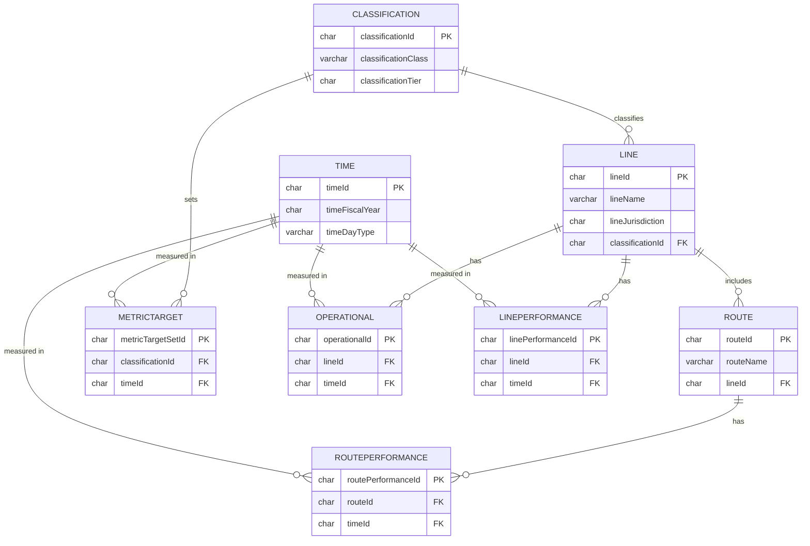

Key metrics tracked include Passengers per Revenue Mile (PPRM), On Time Performance (OTP), Operating Cost per Passenger, Cost Recovery, Crowding, Circuity, and Deadhead miles.

## Repository structure

```
.
├── sql/
│   ├── 00_drop.sql                            Drop tables in dependency order
│   ├── 01_create.sql                          Create the eight table schema
│   ├── 02_insert.sql                          Load the FY2022 to FY2024 data
│   ├── 03_objective1_resource_allocation.sql  Equity and return on investment
│   ├── 04_objective2_compliance_reliability.sql  Targets and service reliability
│   ├── 05_objective3_capacity_alignment.sql   Supply versus demand
│   └── 06_objective4_trends.sql               Year over year trends
├── tableau/
│   ├── objective1.twb  …  objective4.twb      One workbook per objective
├── images/                                    Chart exports used in this README
├── docs/
│   ├── design_document.docx                   Data model, business rules, data dictionary
│   ├── research_report.docx                   Full write up with findings
│   └── presentation.pptx                      Summary slides
└── README.md
```

## How to reproduce

1. Create a database named `BUDT703_Project_0506_11` in SQL Server.
2. Run the SQL files in order: `01_create.sql`, then `02_insert.sql`. Use `00_drop.sql` to reset.
3. Run any objective file to reproduce its analysis.
4. Open the Tableau workbooks in `tableau/` to explore the visualizations.

## The four objectives, with findings and charts

Each chart below is the Tableau visualization that backs the finding above it.

### Objective 1: Resource allocation and equity

**Social value per dollar, by classification and tier.** Commuter lines deliver the highest social value to low income riders per dollar spent, up to 2.4 percent, while Framework lines sit near 0.25 percent. Equity focused investment pays off most on Commuter service.

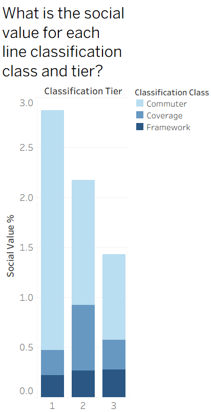

**Cost recovery trend for Commuter lines, FY2022 to FY2024.** Benning Road and Orange Hunt rose sharply, while lines such as Clinton and Bock Road stayed flat and low, a gap worth investigating for transferable practices.

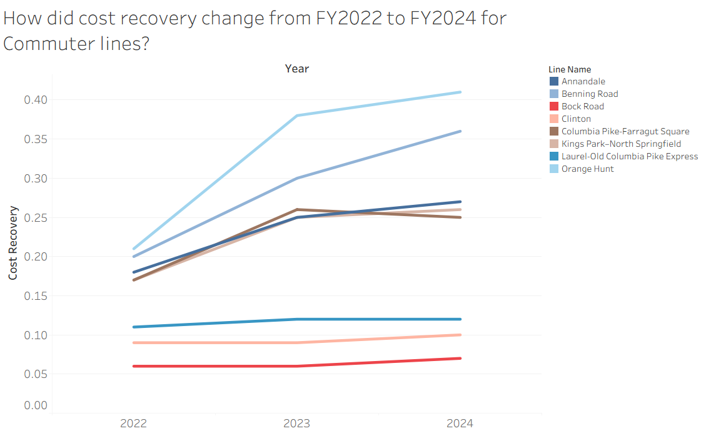

### Objective 2: Compliance and reliability

**On time performance versus target, Framework lines, FY2024 weekday.** Only three Framework lines met the 0.79 target. Most fell below it, and Georgia Avenue to 7th Street trailed at 0.68.

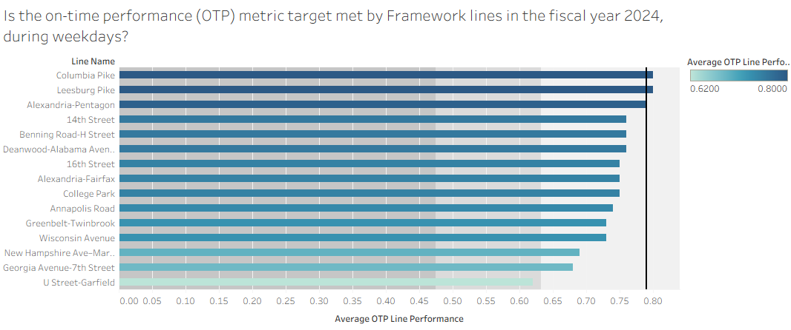

**Service fragility, measured as deadhead share by service type.** Commuter service ran close to half of its mileage out of service, far above Coverage at roughly 15 percent, which flags a structural efficiency problem.

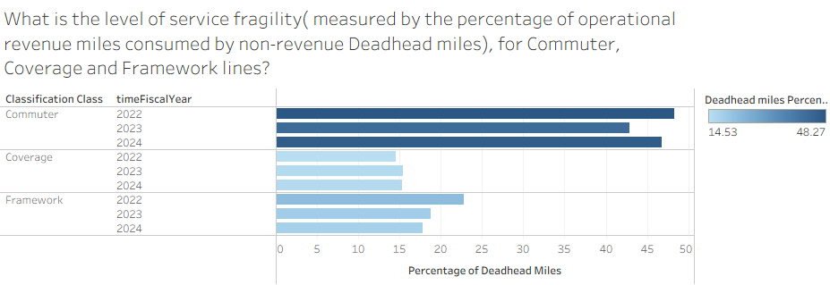

**Framework cost recovery versus target, FY2022 to FY2024.** Framework lines missed the cost recovery target in every fiscal year.

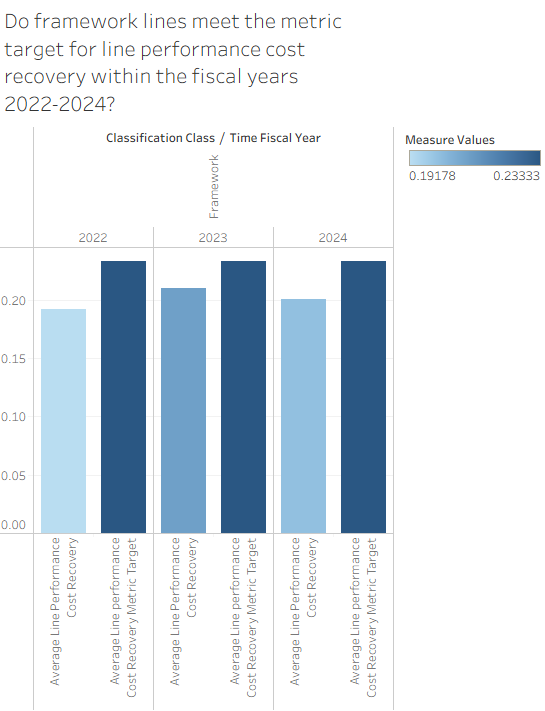

### Objective 3: Capacity and resource alignment

**Peak vehicles per 1,000 residents, by service type and tier.** Framework tiers draw the most vehicles per capita, and secondary tiers oddly out-supply Tier 1.

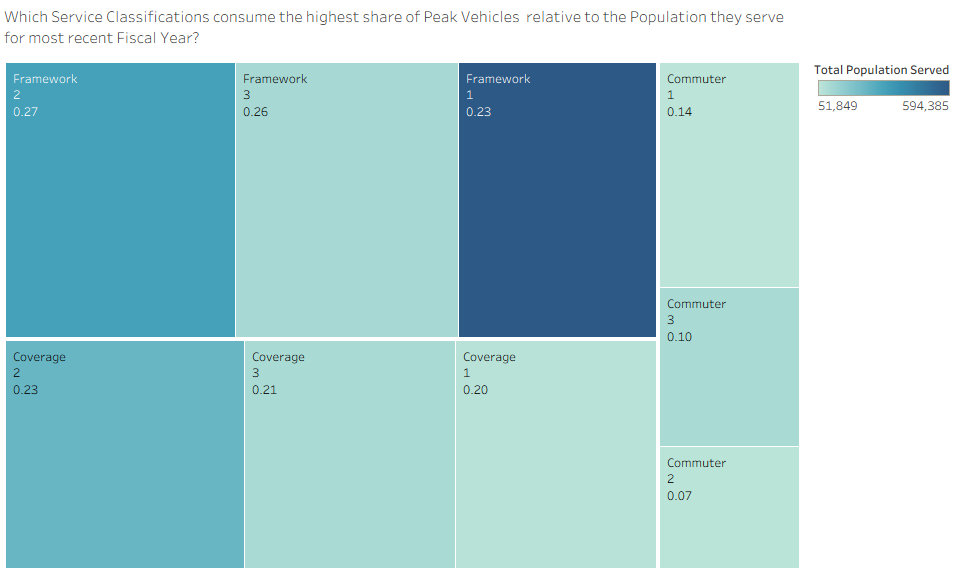

**Crowding versus cost recovery mismatch over time.** United Medical Center to Anacostia is the clear outlier, with a mismatch ratio peaking at 2.33, high demand that fails to translate into financial return.

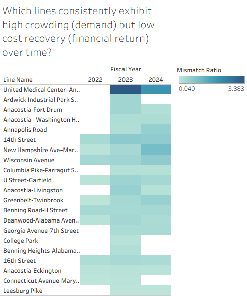

**Weekend cost premium for Framework lines.** Almost every Framework line costs more per passenger on weekends, and Alexandria to Fairfax shows the widest gap.

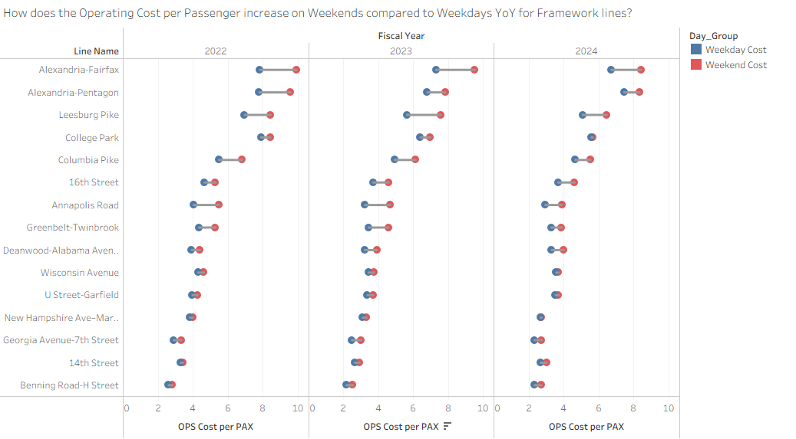

**Ridership versus vehicle allocation gap, by jurisdiction.** DC carries more ridership than its vehicle share, while Virginia holds the largest positive allocation gap.

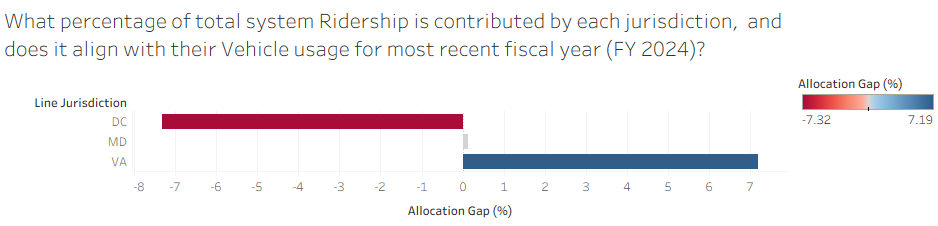

**Crowding versus operating cost, by jurisdiction and service type.** The scatter separates the groups that reach high crowding at low cost from the inefficient ones.

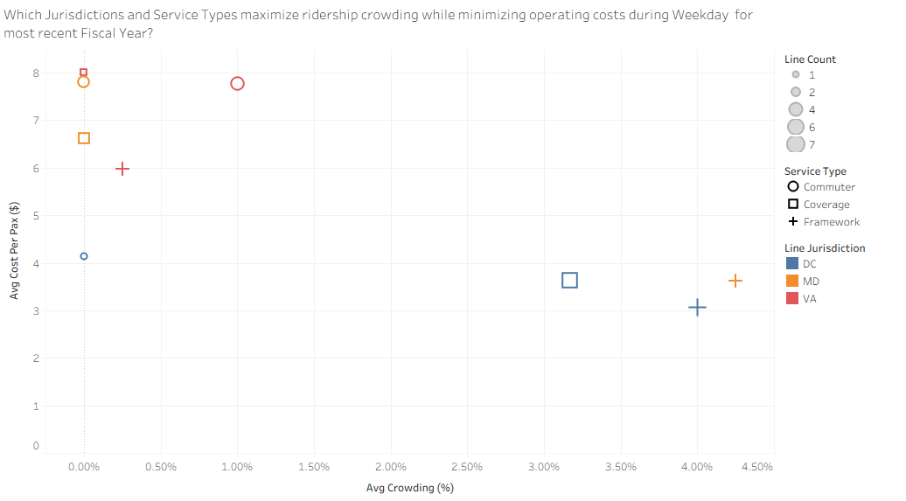

### Objective 4: Performance trends over time

**On time performance by fiscal year and day type.** Weekday OTP dipped slightly across the period, with weekend service tracking close behind.

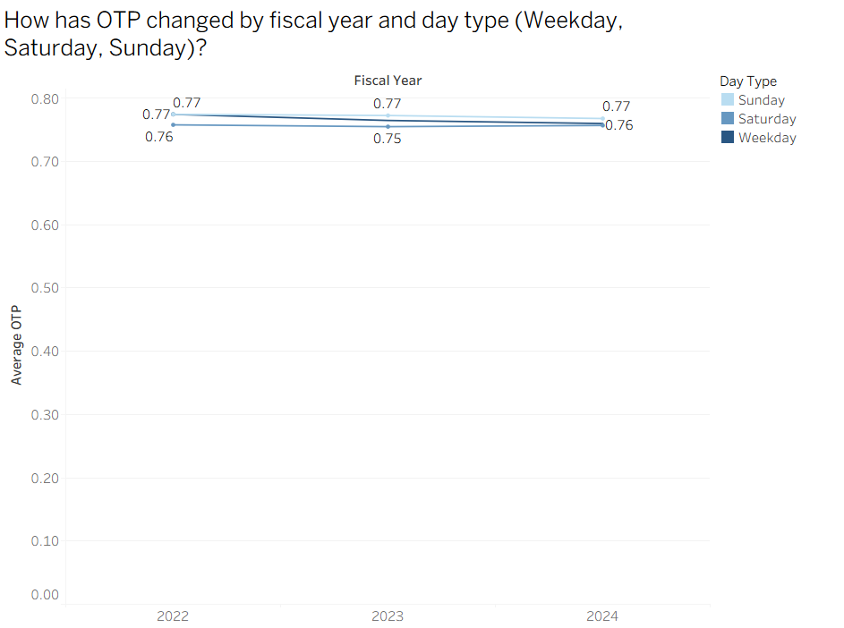

**Passengers per revenue mile, by classification.** Productivity improved for the stronger classifications across the three years.

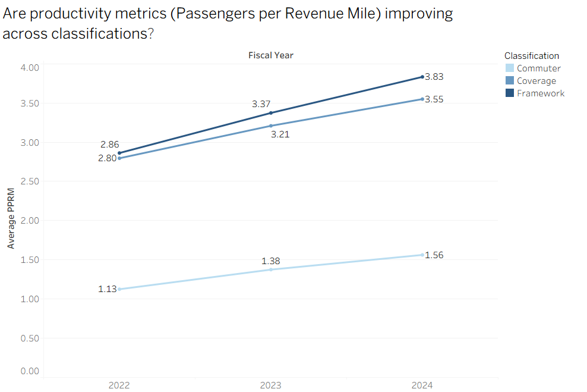

**System wide crowding trend.** Average crowding climbed from 0.01 to 0.02 over the period.

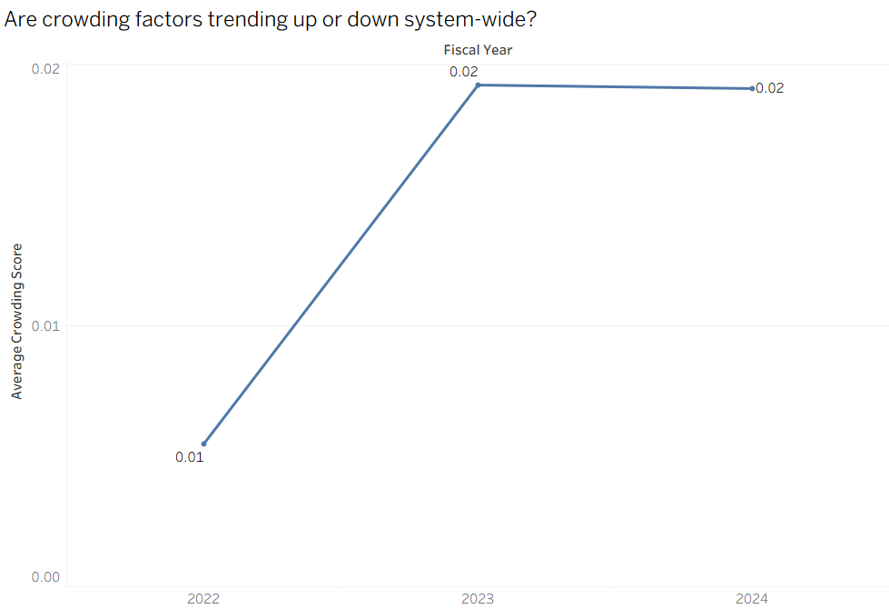

Full numbers and recommendations are in `docs/research_report.docx`.

## Team

This was a four person group project for BUDT703 Database Management Systems at the University of Maryland, Robert H. Smith School of Business. Team members: Ody Adigwe, Kyoungmin Lee, Ioannis Mimigiannis, and Dunyasha S M Yattogoda.

## Note on data

All figures come from WMATA's publicly published annual line performance reports and are used here for academic and portfolio purposes.
